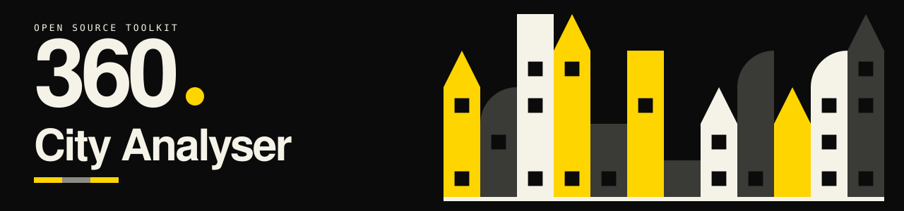
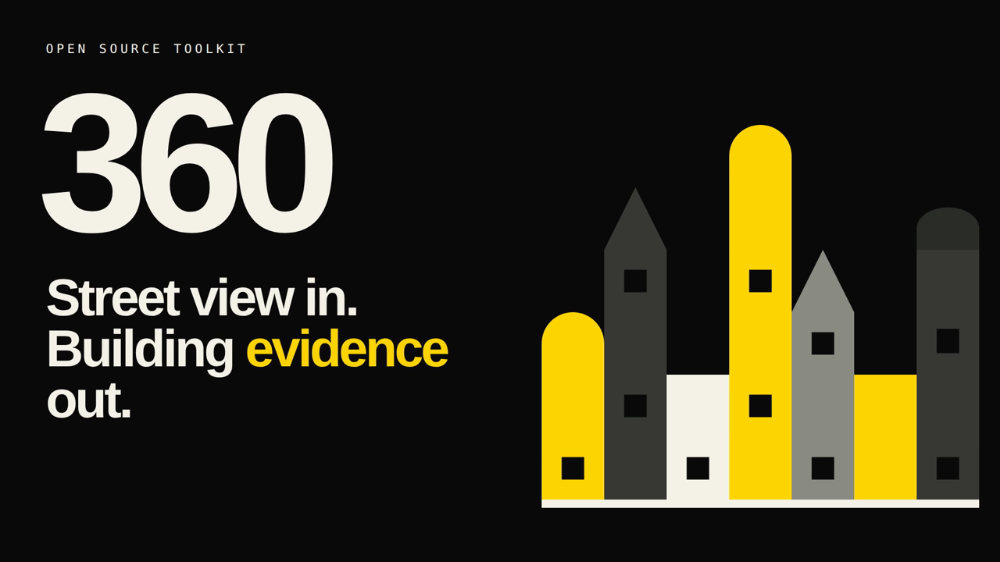
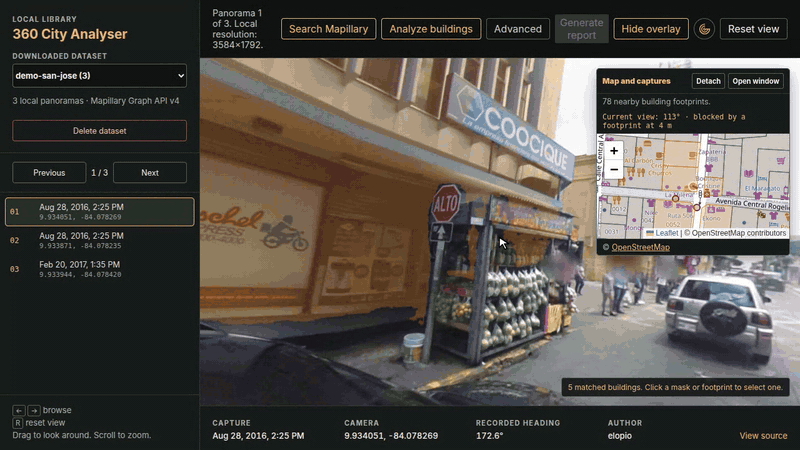

[](https://jsempereh.github.io/360_city_analyser/)

[](https://github.com/JSempereH/360_city_analyser/actions/workflows/ci.yml)
[](LICENSE)
[](pyproject.toml)
[](https://jsempereh.github.io/360_city_analyser/)

Local-first tools to download Mapillary 360 panoramas, view them, segment visible buildings, and associate facade evidence with OpenStreetMap footprints.

[](https://jsempereh.github.io/360_city_analyser/)



[](https://colab.research.google.com/github/JSempereH/360_city_analyser/blob/main/notebooks/colab_quickstart.ipynb)

**Documentation:** https://jsempereh.github.io/360_city_analyser/ (sources in [docs/](docs/)).

## Quick start

```bash
uv sync --extra cpu     # or --extra cu126 on an NVIDIA GPU
uv run city-analyser-models
uv run city-analyser-viewer
```

To let an agent walk a downloaded dataset and describe every building (GEM v3 structure, storeys, use) with a vision-language model on a GPU, run `uv run city-analyser-survey <dataset>`, or open the Colab notebook above. The viewer then shows the result when you click a building, and its presentation mode (`?present=1`) replays the survey as an assistant at work; `uv run city-analyser-demo <dataset>` prepares a presentation copy of an analyzed dataset.

With a local model (Ollama, vLLM) or the model in process, the viewer's **Assistant** tab analyzes a building while you watch and answers questions about it, and every value can be corrected by hand. Survey on a GPU (Colab) and bring the results back with `city-analyser-results export/import`. See [Assistant](docs/guide.md#assistant-analyze-and-talk-in-real-time).

Run the commands from the repository root: datasets (`data/`), model weights (`models/`) and `.env` are read from the working directory.

| Topic | Page |
|---|---|
| Install, download, viewer, analysis, reports, survey agent, evaluation, limits, licenses | [docs/guide.md](docs/guide.md) |
| Run the models on a GPU box, cloud VM or Google Colab | [docs/remote-inference.md](docs/remote-inference.md) |
| Modules, caching, artifact contract, HTTP API | [docs/architecture.md](docs/architecture.md) |
| Footprint corrections | [docs/footprint-corrections.md](docs/footprint-corrections.md) |
| Scaling, hardware, structural attributes | [docs/scaling-and-attributes.md](docs/scaling-and-attributes.md) |
| Experiments, reference data (cadastre) and next steps | [docs/experiments.md](docs/experiments.md) |
| Measured results and candidate models | [docs/state-of-the-art.md](docs/state-of-the-art.md) |
| Prioritized work | [docs/roadmap.md](docs/roadmap.md) |

Preview the site locally with `make docs` (http://127.0.0.1:8000/, live reload; `make docs-build` runs the strict build used in CI).

## Principles

- OSM is the building-footprint source and identity. Local footprint corrections are explicit, reviewed and versioned against the OSM element version; never silent.
- Original Mapillary GPS controls visible camera positions and navigation.
- Refined poses only support image-to-footprint association.
- SfM is optional depth evidence and never replaces the displayed GPS track.
- Reports are deterministic and do not run an LLM or GEM classifier.
- Building attributes from a vision-language model are a separate output: they carry their crops and the model's observations, abstain when views disagree, and are uncalibrated until scored against labeled data.
- The system abstains when its evidence is insufficient or ambiguous.

## License

Code under the [European Union Public Licence v. 1.2](LICENSE) (EUPL-1.2). Imagery, OpenStreetMap data and model weights keep their own terms; read [License and privacy](docs/guide.md#license-and-privacy) before redistributing or using anything commercially.
